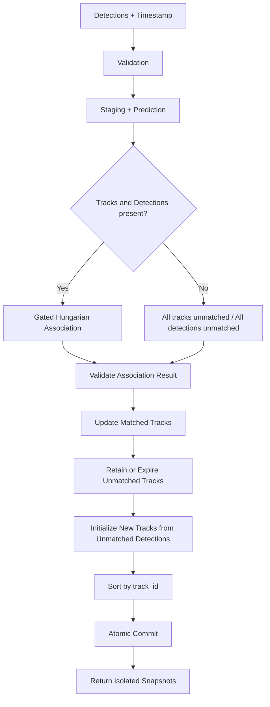

# Architecture – sensor-fusion-ml

**Status:** Phase A (Data Engine) + Phase C (classical baseline including Track Management Lifecycle) + Phase D (minimal trainable model) implemented.
Higher phases are planned and interfaces are reserved.

## Design Goals

1. Explicit data contracts before any learning.
2. Classical baseline that is independently evaluable.
3. Trainable models that never silently mix coordinate frames.
4. First-class support for missing modalities.
5. Colab-first, CPU-testable, GPU-acceleratable.
6. No automatic downloads or heavy training on import.

## Module Map

| Package | Responsibility | Status |
|---------|----------------|--------|
| `data_engine` | Contracts, validation, audit, reports | **Implemented** |
| `sensor_io` | Loaders for real datasets | Planned (interfaces only) |
| `time_sync` | Multi-rate temporal alignment | Planned |
| `calibration` | Intrinsics / extrinsics | Planned |
| `encoders` | Visual & point-cloud feature extractors | Minimal CNN + PointNet implemented |
| `fusion` | Multi-modal fusion networks | `MinimalFusionMLP` implemented |
| `state_estimation` | Kalman & classical filters | `ConstantVelocityKF` + `KalmanState` implemented |
| `tracking` | Data association + Track Management Lifecycle | `hungarian_association`, `greedy_association`, `TrackManager` implemented |
| `trajectory` | Prediction interfaces & kinematic baseline | Implemented |
| `evaluation` | Metrics with GT requirements | MAE/RMSE/ADE/FDE implemented |
| `inference` | Serving & latency | Planned |
| `geometry` | Validated LiDAR-to-camera projection | Implemented (standalone) |

## Classical Tracking Stack (Phase C)

The classical multi-object tracking baseline is composed of three tightly integrated components located under `src/sensor_fusion_ml/`:

### ConstantVelocityKF (`state_estimation/kalman.py`)

- Linear constant-velocity Kalman filter.
- State vector (2D): `[x, y, vx, vy]`
- State vector (3D): `[x, y, z, vx, vy, vz]`
- Observation model observes position only.
- Prediction uses real time delta (`dt = timestamp - state.timestamp`).
- Process noise model is continuous-white-noise acceleration discretized.
- Update uses Joseph form for numerical stability.
- Explicit validation of finite values, symmetry and positive-semidefiniteness of covariance.
- Public methods: `initiate`, `predict`, `update`, `predict_and_update`.

### KalmanState (`state_estimation/kalman.py`)

Dataclass holding:

- `mean`, `covariance`
- `timestamp`
- `track_id` (optional)
- `hits`, `age`, `time_since_update`
- Convenience methods: `position()`, `velocity()`

### Data Association (`tracking/associator.py`)

- Cost = Euclidean distance between track positions and detections.
- Hard gate controlled by `max_cost`.
- Primary solver: SciPy `linear_sum_assignment` on an augmented cost matrix that optimizes cardinality first, then cost.
- Fallbacks when SciPy is unavailable:
  - Exact dynamic-programming solver for matrices with at most 20 tracks and 20 detections.
  - Deterministic gated greedy for larger matrices (explicitly not claimed to be globally optimal).
- Public functions: `hungarian_association`, `greedy_association`.
- Returns ordered matches plus lists of unmatched tracks and unmatched detections.

### TrackManager (`tracking/manager.py`)

Lifecycle manager that orchestrates prediction, association, filtering and expiration.

**Implemented behaviour:**

- Creation of new tracks from unmatched detections via `ConstantVelocityKF.initiate`.
- Prediction of all active tracks to the current timestamp.
- Gated association.
- Measurement update of matched tracks.
- Aging of unmatched tracks (`time_since_update` incremented during predict).
- Expiration when an unmatched track exceeds `max_age`.
- Monotonic track IDs (restarted only by `reset()`).
- Deterministic ordering of returned tracks by `track_id`.
- Snapshot isolation via deep copy.
- Atomic commit: validation and all filter operations occur on staged state; the internal state is mutated only after the full update succeeds.

**Dimensional support:** both 2D and 3D are fully implemented and covered by tests.

**Not present in the current implementation:**

- Explicit semantic lifecycle states (`tentative`, `confirmed`, `deleted`). Only the counters `hits`, `age` and `time_since_update` exist.
- A higher-level `TrackingPipeline` that consumes outputs from fusion / encoders / geometry modules.
- Automatic coordinate-frame transformations.

The `TrackManager` is a self-contained library component. It is not yet wired into an end-to-end operational pipeline that joins detection models with tracking.

## Implemented Tracking Flow

## Known Limitations (current delivery)

- No real dataset loaders yet (by design – licensing must be reviewed first).
- No end-to-end TrackingPipeline that integrates detectors, fusion and TrackManager.
- No explicit semantic track states (`tentative` / `confirmed` / `deleted`); only counters are maintained.
- No uncertainty calibration or probabilistic heads yet.
- Trajectory horizon is fixed at construction time.
- Visual encoder is intentionally tiny (software validation only).
- MOT-specific metrics (MOTA, IDF1, HOTA, ID switches, fragmentation) are not yet implemented.
- Coordinate-frame transformations between image, LiDAR, world or geographic frames must be performed externally before calling TrackManager.
- Origin, axis convention and physical units of the Cartesian frame used by TrackManager are not yet formalized in code; they are treated as an external contract.

## Related Documents

- `docs/tracking_data_contract.md` – formal contracts for detections, coordinates, timestamps and track lifecycle.
- `docs/evaluation_protocol.md` – implemented metrics versus planned MOT metrics.
- `docs/geometry_projection.md` – LiDAR-to-camera projection (standalone).
